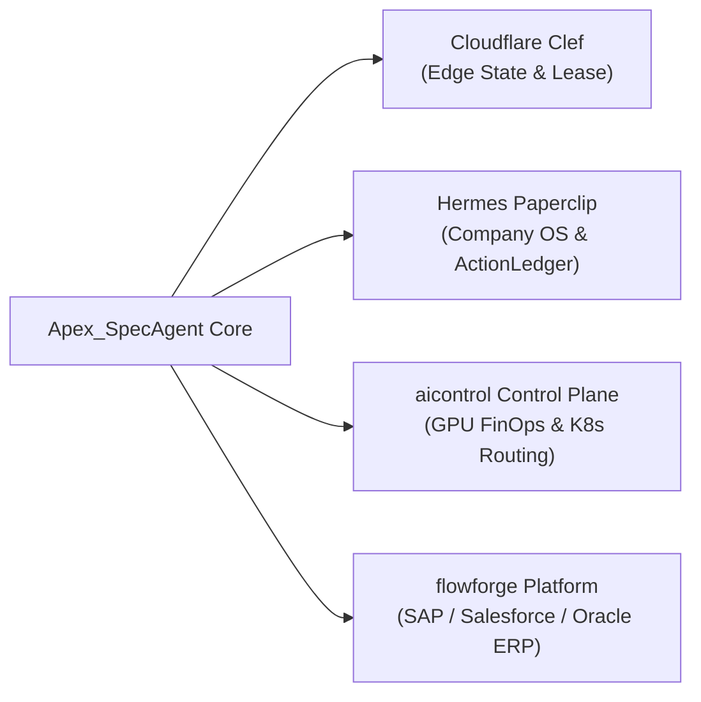
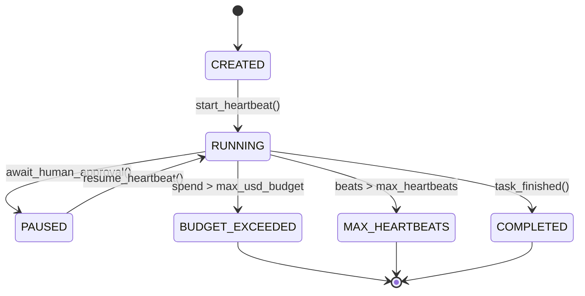

# Apex_SpecAgent Enterprise Integration Guide

## 1. Overview & Ecosystem Architecture

Apex_SpecAgent integrates four strategic enterprise fabrics into a unified, high-throughput execution runtime:

1. **Cloudflare Clef**: Distributed edge state coordination, sub-millisecond lease tokens, and cross-datacenter speculative KV cache replication.
2. **Hermes Paperclip Adapter (`@paperclipai/hermes-paperclip-adapter`)**: Company OS budget governance, multi-heartbeat lifecycle management, and cryptographic SHA-256 `ActionLedger` audit receipts.
3. **Enterprise AI Production Control Plane (`aicontrol`)**: Kubernetes GPU FinOps accounting, hourly GPU cost amortization, incident triage reporting, and multi-cloud inference routing.
4. **Enterprise AI Integration Platform (`flowforge`)**: Durable enterprise workflow execution across SAP S/4HANA, Salesforce CRM, Oracle ERP, Stripe Payments, and FedEx Logistics with transactional idempotency and replay safety.



---

## 2. Cloudflare Clef Edge Integration

Cloudflare Clef provides distributed coordination to ensure that an agent roaming across edge regions (e.g., San Jose, Ashburn, London, Tokyo, Frankfurt) maintains warm Radix KV prefixes without cold-start prefill penalties.

### Integration Contract

```python
from apex_specagent.adapters.clef_adapter import CloudflareClefAdapter

clef = CloudflareClefAdapter(primary_region="iad-edge-01")

# 1. Acquire distributed lease in < 50us
lease = clef.acquire_edge_lease(agent_id="AGENT-ROAM-01", ttl_seconds=60)
print(f"Lease acquired: {lease.lease_id}, Token: {lease.token}")

# 2. Replicate active Radix prefix state across global edge nodes
sync_result = clef.sync_speculative_kv_prefix(
    agent_id="AGENT-ROAM-01",
    prefix_hash="radix_slot_42_hash",
    slot_id=42,
    tokens_count=32000,
)
print(f"Prefix synced across: {sync_result['replicated_regions']}")
```

---

## 3. Hermes Paperclip Adapter (`@paperclipai/hermes-paperclip-adapter`)

Paperclip formalizes agent autonomy into governed business tasks with hard USD budget limits and multi-heartbeat lifecycles:



### Integration Contract

```python
from apex_specagent.adapters.paperclip_adapter import HermesPaperclipAdapter

paperclip = HermesPaperclipAdapter()

# 1. Initialize task with $0.10 budget and 25 max heartbeats
task = paperclip.create_task(
    task_id="TASK-SWARM-001",
    goal="Autonomous Speculative Code Refactoring",
    max_usd_budget=0.10,
    max_heartbeats=25,
)

# 2. Heartbeat execution & token burn tracking
paperclip.start_heartbeat(task.task_id)
burn = paperclip.record_token_burn(
    task_id=task.task_id,
    prompt_tokens=42000,
    completion_tokens=500,
    is_speculative=False,
)
print(f"Spent: ${burn['total_spent_usd']}, Remaining: ${burn['remaining_budget_usd']}")

# 3. Emit immutable SHA-256 ActionLedger receipt
receipt = paperclip.emit_action_receipt(
    task_id=task.task_id,
    action_type="SPECULATIVE_COMMIT",
    details={"tool": "git_diff", "recomp_saved": "94.2%"},
)
print(f"ActionLedger Receipt: {receipt}")
```

---

## 4. Enterprise AI Production Control Plane (`aicontrol`)

Directly interfaces with [enterprise-ai-production-control-plane](https://github.com/AAH20/enterprise-ai-production-control-plane) (`src/aicontrol/`):

- **`aicontrol.economics`**: Ingests hourly GPU amortization rates (NVIDIA GB200, H100 SXM5, A3) and calculates unit cost per million speculative tokens.
- **`aicontrol.router`**: Selects optimal multicloud compute targets (on-prem Blackwell vs. AWS P5 vs. GCP A3) balancing price and latency SLAs.
- **`aicontrol.incidents`**: Automatically triages GPU memory pressure or speculative branch failure incidents.

### Integration Contract

```python
from apex_specagent.adapters.control_plane_adapter import ProductionControlPlaneAdapter

control_plane = ProductionControlPlaneAdapter(cluster_id="k8s-prod-us-east-1")

# Fetch real-time FinOps telemetry
finops = control_plane.get_finops_telemetry(current_utilization_pct=94.5)
print(f"GPU Hardware: {finops.gpu_type}, Cost: ${finops.gpu_cost_per_hour}/hr")

# Route speculative batch across multicloud targets
route = control_plane.route_speculative_batch(batch_size=64, max_latency_ms=100.0)
print(f"Routed Target: {route['selected_provider']}, Latency: {route['estimated_latency_ms']}ms")
```

---

## 5. Enterprise AI Integration Platform (`flowforge`)

Directly interfaces with [enterprise-ai-integration-platform](https://github.com/AAH20/enterprise-ai-integration-platform) (`src/flowforge/`):

- **Transactional Idempotency**: Prevents speculative actions from executing destructive unverified side effects on production ERPs (SAP S/4HANA, Salesforce CRM, Oracle ERP).
- **Two-Phase Commit**:
  1. *Phase 1 (Speculative Stage)*: Prepares mutation in an isolated transaction sandbox.
  2. *Phase 2 (Primary Verification)*: Atomically commits to the ERP when primary LLM confirms, or rolls back cleanly if the speculative branch was discarded.

### Integration Contract

```python
from apex_specagent.adapters.integration_platform_adapter import EnterpriseIntegrationPlatformAdapter

integration = EnterpriseIntegrationPlatformAdapter()

# 1. Stage speculative action payload
staged_tx = integration.stage_speculative_transaction(
    workflow_id="WF-PO-CREATE",
    target_system="SAP_S4HANA",
    idempotent_key="IDEMP-PO-49102",
    payload={"po_id": 49102, "supplier": "ACME", "amount": 18450.0},
)

# 2. Primary model verifies intent -> Atomically commit
commit_result = integration.commit_staged_transaction(idempotent_key="IDEMP-PO-49102")
print(f"SAP Transaction: {commit_result['status']}, Receipt: {commit_result['receipt_hash']}")
```
